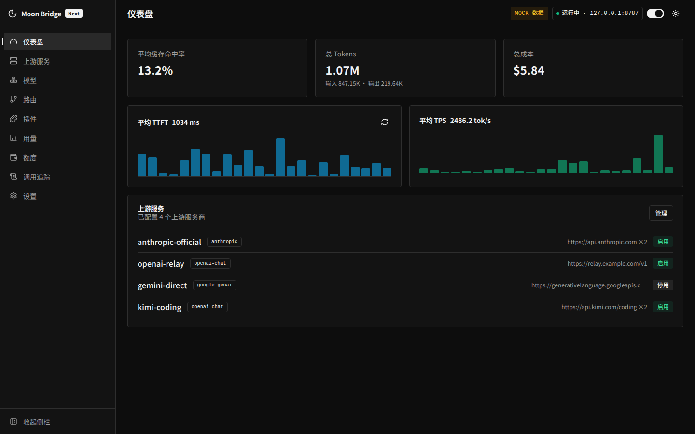
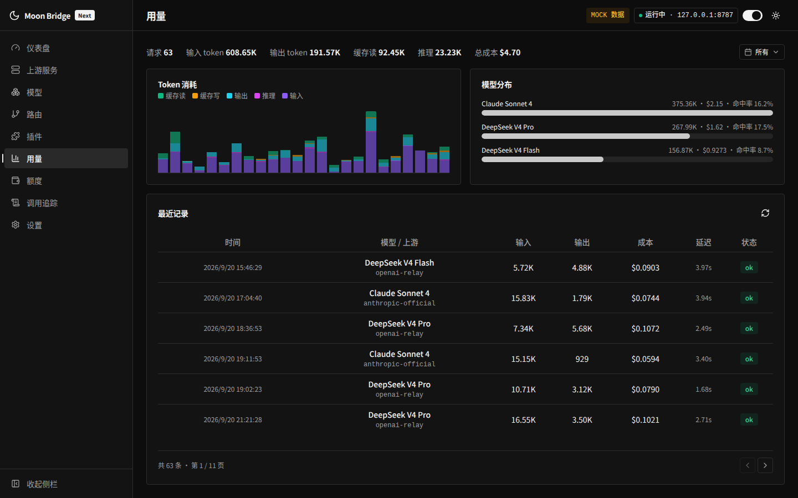
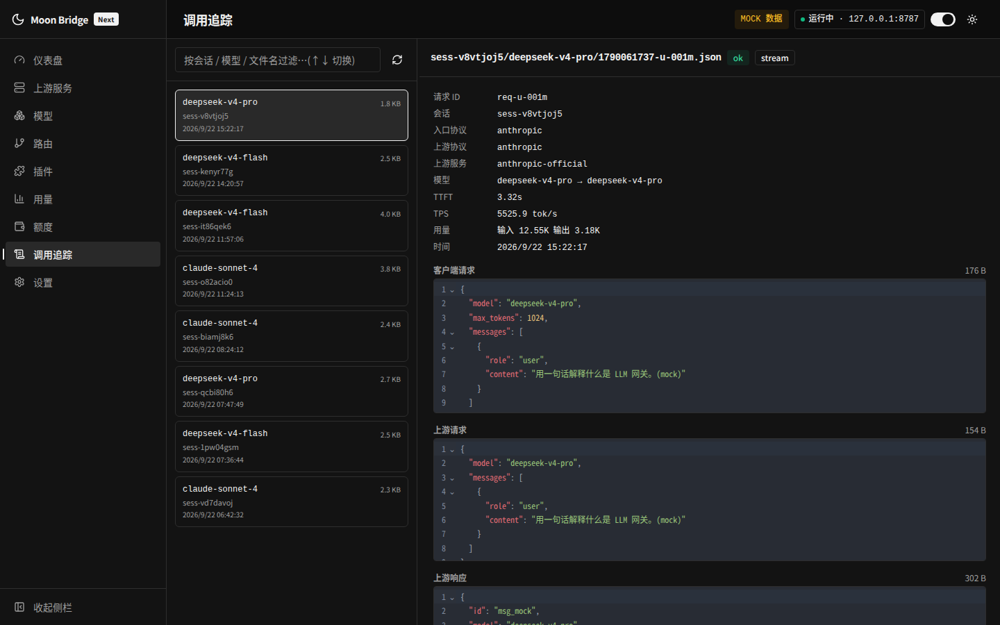
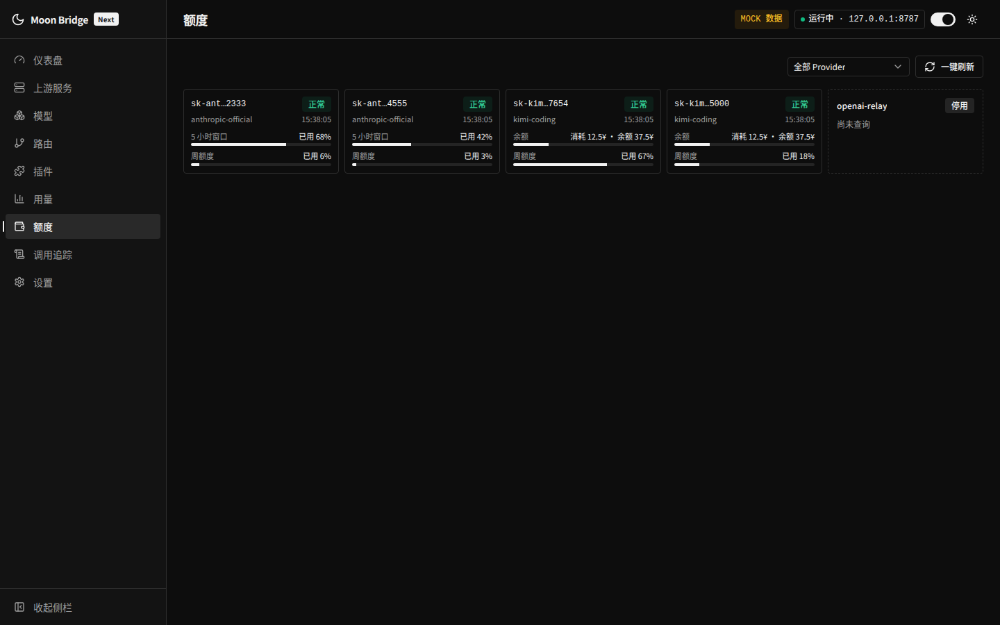
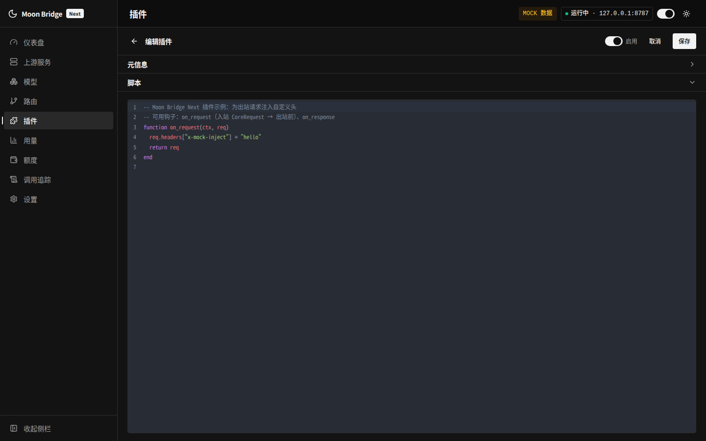
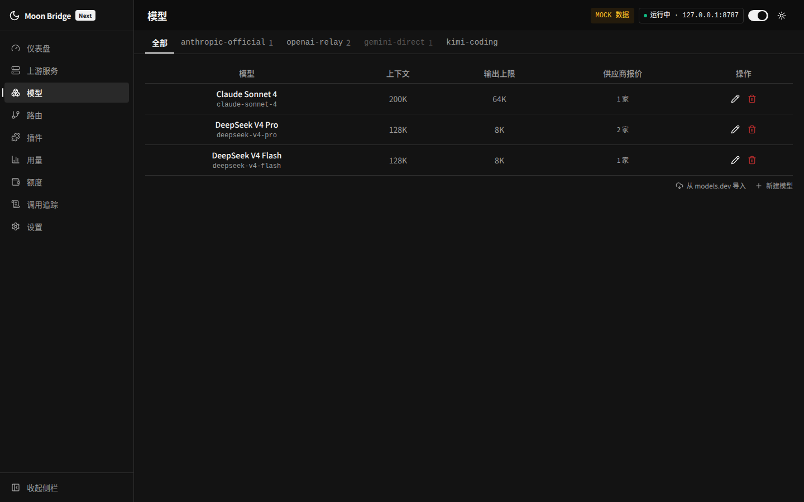

<div align="center">

# Moon Bridge Next

### 本地 LLM 网关：协议转换 · Lua 插件 · 用量与配额看板

[](LICENSE)
[]()
[](https://tauri.app/)
[](https://www.rust-lang.org/)
[](https://vuejs.org/)

[English](README.en.md) · 中文 · [架构文档](docs/architecture.md) · [开发指南](DEVELOPMENT.md)

</div>

## 概述

不同模型工具与上游服务商使用各自的 API 协议：Claude Code 使用 Anthropic Messages，Codex 使用 OpenAI Responses，多数通用工具使用 Chat Completions。切换上游往往需要调整客户端或重写配置。

Moon Bridge Next 部署在客户端与上游服务商之间，将客户端请求转换为目标上游协议并转发。网关内置 Lua 5.4 插件系统，支持修改统一的请求/响应中间表示（Core IR）或直接改写原始 HTTP 报文与 SSE 事件流。所有配置通过内置管理界面完成。

- **四协议双向转换**：支持 OpenAI Responses、OpenAI Chat Completions、Anthropic Messages、Google Gemini 之间的流式与非流式互转。
- **双层 Lua 插件**：语义层（`core`）基于 Core IR 编写一次即可跨协议生效；报文层（`raw_*`）直接读写 HTTP 请求头、报文体与 SSE chunk。
- **用量统计与配额监控**：按请求记录五类 token 计数、延迟与费用；内置 12 个上游配额查询插件，支持按 API Key 监控余额与速率限制。
- **四阶段请求留痕（Traces）**：落盘记录入站请求、出站请求、上游响应、客户端响应的原始报文快照，便于排查协议转换与插件改写。
- **桌面端与无头服务端**：提供 Tauri 桌面应用，以及单端口托管网关、管理 API 与前端页面的 `moonbridge-server`。
- **凭据静态加密**：使用 AES-GCM 加密存储 Provider API Key 与配额查询配置，支持入口令牌鉴权、私网白名单与出站代理。

## 界面截图

|                    仪表盘                     |                  用量计量                  |
| :-------------------------------------------: | :----------------------------------------: |
|      |         |
|                  **调用追踪**                 |                **额度看板**                |
|       |         |
|                 **插件编辑器**                |                **模型目录**                |
|  |    |

## 协议支持

网关通过统一的中间表示 Core IR（`CoreRequest` / `CoreResponse` / `CoreStreamEvent`）解耦入口协议与上游协议。入站请求先归一化为 Core IR，再由上游适配器编码为目标协议，将 N×M 的转换复杂度收敛为 N+M。

| 协议 | 入口（客户端 → 网关） | 上游（网关 → 服务商） |
|------|:---:|:---:|
| OpenAI Responses（`/v1/responses`） | ✓ | ✓ |
| OpenAI Chat Completions（`/v1/chat/completions`） | ✓ | ✓ |
| Anthropic Messages（`/v1/messages`） | ✓ | ✓ |
| Google Generative AI / Gemini | 已实现适配器，未挂载路由 | ✓ |

四种协议的双向适配均支持非流式与流式（SSE）。Core IR 统一了内容块类型（文本、图像、文档、工具调用、工具结果、推理）与 token 统计口径（`input_tokens` 含缓存读写，`output_tokens` 含推理 token）。

此外提供 `GET /health`（健康检查）与 `GET /v1/models`（模型列表）两个辅助端点。

## 功能特性

### Provider 与模型管理

- **多端点故障转移**：单个 Provider 可配置多个端点，每个端点拥有独立的协议、Base URL 与 API Key，请求按端点顺序自动故障转移。
- **模型目录**：支持从 models.dev 检索并批量导入模型的上下文窗口、最大输出 token、模态、推理档位与定价，也支持手动维护。
- **Offer 与定价**：模型通过 Offer 关联到 Provider。Offer 记录分项单价（USD / 1M tokens，含输入、输出、缓存读、缓存写、推理及长上下文分档计价），并可指定端点协议以控制多协议 Provider 的路由走向。
- **路由别名**：客户端通过别名请求模型，网关将别名解析为具体的「Provider + 上游模型」，切换上游对客户端透明。

### 用量统计

每次请求记录会话 ID、客户端模型、上游模型、Provider、五类 token（输入、输出、缓存读、缓存写、推理）、首 token 延迟（TTFT）、总延迟、状态（`ok` / `error` / `aborted`）与费用。费用按请求发生时命中的 Offer 价目计算，后续修改价目不影响历史记录。用量页面提供汇总卡片、token 时序图、模型分布与请求明细。

### 请求留痕（Traces）

开启 Trace 后，网关在入站请求、出站请求、上游响应、客户端响应四个阶段将报文快照写入磁盘。流式响应由网关从事件流聚合还原为完整消息体后再保存，便于对比上游原始输出与客户端实际接收内容。Traces 页面支持检索、四阶段对照查看与清理。

### 配额看板

配额页按 Provider 分组展示各端点 API Key 的配额与健康状态。Provider 绑定 `quota` 类插件后，配额引擎对每个端点 Key 独立执行 `MB.query` 并分行展示掩码 Key、状态与额度进度条。

内置配额插件覆盖 new-api、Sub2API、DeepSeek、Moonshot/Kimi、SiliconFlow、OpenRouter、智谱 GLM Coding Plan、Kimi Coding Plan、CommandCode、Claude Code 等常见上游；也可在插件页编写自定义 `quota` 插件，通过 `mb.http.request` 请求上游接口并返回百分比、金额或计数器类型的配额结构。Provider 编辑页支持配置轮询间隔、加密实例参数及保存前试跑预览；单次查询失败时保留该 Key 最近一次成功数据并标记异常。

### 会话识别

网关按以下优先级识别会话身份，用于隔离插件 `mb.session` 状态与归类 Trace 目录：

1. 入站报文层插件覆写 `msg.session_id`（仓库在 `plugins/harness/` 下提供了 Claude Code、Codex、OpenCode、Kimi Code、Grok Build、DSH 等客户端的会话提取预设）。
2. 请求显式携带的标识：请求体中的 `session_id`、`previous_response_id`，或请求头 `X-Codex-Window-Id`。
3. 会话水印（Session Marker）：对不携带会话标识的客户端，网关在响应的首个非加密推理（CoT）块首部嵌入 `[mb:<载荷>]` 标记。客户端下一轮带回历史消息时，网关从中提取会话 UUID 并还原身份。标记在入站解析后立即剥除，不会转发给上游模型。该特性可在设置中关闭，关闭后入站消息中的存量标记仍会被剥除。

### 访问控制

桌面模式下可配置网关入口令牌（`auth_token`），开启后客户端 POST 请求需携带 `Authorization: Bearer <token>`；未配置时不校验，仅适合本机回环监听。Web 服务端模式强制要求配置相互独立的管理令牌（`--admin-token`）与网关令牌（`--gateway-token`）。`GET /health` 与 `GET /v1/models` 始终公开访问。

## 快速开始

1. 启动应用，网关默认监听 `127.0.0.1:38440`（可在 Settings 中修改）。
2. 在 **Providers** 页面添加上游服务商，配置协议、Base URL 与 API Key（可添加多个端点用于故障转移）。
3. 在 **Models** 页面从 models.dev 导入或手动新建模型，并为目标 Provider 创建 Offer。
4. 在 **Routes** 页面创建模型别名，指向目标「Provider + 模型」。
5. 将客户端指向网关地址，模型名填写路由别名：
   - OpenAI 兼容客户端（Chat / Responses）：Base URL 设为 `http://127.0.0.1:38440/v1`
   - Anthropic 客户端：Base URL 设为 `http://127.0.0.1:38440`
   - API Key：若配置了 `auth_token` 则填该令牌，否则填任意非空字符串
6. 如需启用插件，在 **Plugins** 页面配置绑定后点击「重启网关」生效。

源码构建与开发方式见 [DEVELOPMENT.md](DEVELOPMENT.md)。

## 插件系统

插件运行在独立的 Lua 5.4 沙箱中，分为两层钩子：

- **语义层（`core`）**：在协议归一化后触发，操作统一的 Core IR，一次编写适用于所有协议。
- **报文层（`raw_request` / `raw_response` / `raw_stream`）**：在协议转换外层触发，直接读写 HTTP 请求头、报文体与流式 SSE chunk。

### 常见用途

语义层（`core`）：
- 注入或修改 system 提示词、追加上下文消息、调整 `temperature` / `max_tokens` / `reasoning` 等生成参数
- 通过 `inject_tools` 动态注入工具定义
- 通过 `filter_content` 过滤指定类型的内容块（如剥除推理过程）或通过 `on_stream_event` 丢弃特定流事件
- 统一改写错误提示、记录结构化日志、按会话统计状态（`mb.session`）

报文层（`raw_*`）：
- 增删改 HTTP 请求/响应头，补充上游专有头、覆写 `User-Agent` 或使用 `mb.crypto` 计算请求签名
- 改写出站 JSON 请求体、执行自定义入口鉴权（返回 `abort`）或命中缓存直接本地应答（返回 `short_circuit`）
- 上游瞬时错误重试：在 `on_upstream_response_raw` 的错误路径（`msg.error == true`）返回 `retry`，由网关延迟后重发请求（内置 `plugins/utils/rescue_5xx.lua` 与 `rescue_fake_200.lua`）
- 过滤无意义的 SSE 心跳帧，或调用 `mb.provider.invoke` 跨 Provider 编排请求

### 插件清单（`MB`）

脚本执行后需暴露全局 `MB` 表，包含元数据清单与钩子函数：

| 字段 | 说明 |
|------|------|
| `name` | 插件唯一名称（以 Plugins 页面登记名称为准） |
| `version` | 版本号 |
| `category` | 插件类别：`core`（默认，请求链路插件）或 `quota`（配额查询插件） |
| `scopes` | 允许挂载的作用域：`global` / `provider` / `model` / `route` |
| `capabilities` | 启用的钩子层：`core` / `raw_request` / `raw_response` / `raw_stream` |
| `config_schema` | 可选，插件配置的 JSON Schema，前端据此渲染配置表单 |
| `requires` | 可选，启用前提（如 `{ sessionMarker = true }`），不满足时拒绝启用 |
| `init` / `shutdown` | 可选，网关启动前与停止后按加载顺序/逆序调用的生命周期函数 |

### 语义层钩子

| 钩子 | 说明 |
|------|------|
| `on_request(ctx, req)` | 修改 `CoreRequest`；支持就地修改 `req` 或返回新 table |
| `inject_tools(ctx)` | 返回需追加的 `Tool` 数组 |
| `on_response(ctx, resp)` | 修改非流式 `CoreResponse` |
| `on_stream_event(ctx, ev)` | 处理流式事件，返回 `true` 则丢弃该事件 |
| `filter_content(ctx, block)` | 返回 `true` 则移除该内容块（流式模式下同步压制该块的后续增量） |
| `transform_error(ctx, msg)` | 返回改写后的错误消息字符串 |

`CoreRequest` 主要字段：`model`（解析后的上游模型名）、`model_alias`、`system`（`ContentBlock` 数组）、`messages`、`tools`、`tool_choice`、`max_tokens`、`temperature`、`top_p`、`stop`、`stream`、`reasoning`、`meta`。
`CoreResponse` 主要字段：`id`、`model`、`content`、`stop_reason`、`usage`（`input_tokens` / `output_tokens` / `cache_read_tokens` / `cache_write_tokens` / `reasoning_tokens`）。

### 报文层钩子

| 钩子 | 所需能力 | 触发时机 |
|------|---------|---------|
| `on_client_request_raw(ctx, msg)` | `raw_request` | 入站请求（客户端 → 网关） |
| `on_upstream_request_raw(ctx, msg)` | `raw_request` | 出站请求（网关 → 上游） |
| `on_upstream_response_raw(ctx, msg)` | `raw_response` | 上游响应（含非 2xx 错误响应及流式零产出失败，此时 `msg.error = true`） |
| `on_client_response_raw(ctx, msg)` | `raw_response` | 客户端响应（网关 → 客户端，非流式） |
| `on_upstream_chunk_raw(ctx, chunk)` | `raw_stream` | 上游入站 SSE chunk |
| `on_client_chunk_raw(ctx, chunk)` | `raw_stream` | 客户端出站 SSE chunk |

- `msg` 字段：`stage`、`protocol`、`provider`、`method`、`url`、`status`、`headers`（保序数组 `{{k, v}, ...}`）、`body`（JSON table / 字符串 / nil；超过大小上限时为 `nil` 且 `body_truncated = true`）、`session_id`（仅 `client_request` 阶段可写以覆写会话身份）、`error`（只读布尔值，标识上游错误路径）。出站请求的 `method`、`url`、`headers`、`body` 均支持就地修改。
- `chunk` 字段：`stage`、`protocol`、`provider`、`event`、`data`、`raw`。
- 返回值约定：
  - 返回 `nil`：放行（保留对 `msg` / `chunk` 的就地修改）。
  - `{ action = "short_circuit", status?, headers?, body? }`：直接返回本地响应，跳过后续流程与上游调用。
  - `{ action = "abort", message? }`：中止请求并返回错误。
  - `{ action = "retry", delay_ms? }`：延迟后重发本次上游请求。仅在 `on_upstream_response_raw` 的错误路径（`msg.error == true`）生效，触发后立即进入重试轮次，不再执行同阶段后续插件。重试次数与单次延迟受配置项 `pluginRetryMax`（默认 8，0 为禁用）和 `pluginRetryDelayCapMs`（默认 30000ms）限制。
  - `{ action = "drop" }`：仅用于 chunk 钩子，丢弃当前 SSE chunk。

未声明 `raw_stream` 能力的插件在流式转发期间不会触发任何 Lua 调用。

### 上下文与宿主 API（`mb`）

每次钩子调用传入只读上下文 `ctx`，包含：`request_id`、`session_id`、`model_alias`、`client_protocol`（`openai-response` / `openai-chat` / `anthropic` / `google-genai`）、`upstream_protocol`、`provider`、`stream`。

全局表 `mb` 提供宿主 API（其中 `http.request` 与 `provider.invoke` 为异步调用）：

| API | 说明 |
|-----|------|
| `mb.log.debug / info / warn / error(msg)` | 输出带插件名的结构化日志 |
| `mb.config` | 当前绑定下的插件配置表 |
| `mb.session.get(k)` / `mb.session.set(k, v)` | 按「插件名 + 会话 ID」隔离的会话级键值存储 |
| `mb.http.request({ method, url, headers, body, timeout_ms })` | 发送 HTTP 请求，返回 `{ status, headers, body }`（默认超时 30 秒，遵循宿主出站代理配置） |
| `mb.provider.invoke(provider, model, req)` | 使用 Core IR 调用指定 Provider，返回 `CoreResponse` |
| `mb.headers.get / set / remove(headers, name)` | 大小写不敏感、保持原有顺序的报文头操作辅助函数 |
| `mb.crypto.sha256 / hmac_sha256 / base64_encode / base64_decode` | 哈希摘要与 Base64 编解码工具 |

### 插件示例

以下插件同时使用 `core` 与 `raw_request` 能力，在语义层注入 system 提示词并统计会话请求次数，在报文层附加请求头并限制 `max_tokens`：

```lua
MB = {
  version = "1.0.0",
  scopes = { "global", "provider" },
  capabilities = { "core", "raw_request" },
  config_schema = {
    type = "object",
    properties = {
      prefix     = { type = "string", title = "注入到 system 的提示语" },
      max_tokens = { type = "number", title = "max_tokens 上限" },
    },
  },
}

function MB.on_request(ctx, req)
  local n = (mb.session.get("count") or 0) + 1
  mb.session.set("count", n)
  mb.log.info(string.format("[%s] 会话 %s 第 %d 次请求",
    ctx.model_alias, ctx.session_id or "anon", n))
  table.insert(req.system, 1,
    { type = "text", text = mb.config.prefix or "回答尽量简短。" })
end

function MB.on_upstream_request_raw(ctx, msg)
  msg.headers = mb.headers.set(msg.headers, "x-moonbridge-session", ctx.session_id or "anon")
  if type(msg.body) == "table" then
    local cap = mb.config.max_tokens or 8192
    if msg.body.max_tokens and msg.body.max_tokens > cap then
      msg.body.max_tokens = cap
    end
  end
end
```

### 沙箱限制与参考实现

每个插件运行在独立的受限 Lua 虚拟机中：
- 移除 `os`、`io`、`loadfile`、`dofile`、`require`、`package` 全局库。
- 通过调试钩子限制单次调用指令数（默认 2 亿条，覆盖插件内创建的协程）与执行超时，防止死循环阻塞。
- 限制虚拟机内存上限（默认 1024 MB）；超过大小阈值（默认 100 MB）的报文体不展开为 Lua table，标记 `body_truncated` 后原样转发。
- 单个插件执行报错仅记录警告并跳过该插件，不中断主请求链路。

仓库内置插件与类型定义：
- `plugins/examples/log_request.lua`：语义层插件示例（日志、会话计数、system 注入、错误改写）。
- `plugins/examples/raw_rewrite.lua`：报文层插件示例（鉴权、请求头与报文体改写、SSE 心跳丢弃）。
- `plugins/harness/*.lua`：各类 AI 编程客户端的会话标识提取插件。
- `plugins/utils/FxxkDax.lua`：出站会话标识头注入插件。
- `plugins/utils/rescue_5xx.lua`、`plugins/utils/rescue_fake_200.lua`：上游 5xx/429 及流式空响应指数退避重试插件。
- `plugins/moonbridge.lua`：LuaLS 类型定义文件。将其所在目录加入 `Lua.workspace.library` 即可获得 `MB` 与 `mb` 的代码补全与类型提示。

## 部署与安全

### 桌面端

桌面应用内置系统托盘与完整管理界面（Dashboard、Providers、Models、Routes、Plugins、Usage、Quota、Traces、Settings），支持开机自启、窗口状态记忆与一键启停网关。

### 无头服务端（`moonbridge-server`）

无桌面环境可使用 `moonbridge-server`，在单一端口同时提供 LLM 网关路由、`/api/*` 管理接口与前端静态资源托管：

- **双令牌隔离**：管理接口必须通过 `--admin-token` 或 `MOONBRIDGE_ADMIN_TOKEN` 注入管理令牌（仅驻留内存，不落盘、不回显）。LLM 网关入口通过 `--gateway-token`、`MOONBRIDGE_GATEWAY_TOKEN` 或配置文件提供独立的网关令牌，两者不得相同。前端页面仅在内存中保存登录令牌，刷新页面需重新认证。
- **平滑重启**：点击「重启网关」将在进程内排空在途请求、执行插件 `shutdown`/`init` 钩子并重新绑定端口，无需外部进程管理器介入。
- **容器化部署**：根目录提供多阶段 `Dockerfile`（以非特权用户 `uid 10001` 运行），`deploy/soul/` 下提供 Docker Compose 部署示例。公网暴露时建议前置 TLS 反向代理。

### 凭据加密与备份

数据库中的 Provider API Key 与配额查询配置采用 AES-GCM 静态加密。密钥文件默认存放在 `<db>.key`（可通过 `--key-file` 或 `MOONBRIDGE_KEY_FILE` 指定）：
- Unix 系统下密钥文件权限强制为 `0600`；Windows 系统下使用当前用户 DPAPI 封装密钥。
- 密钥缺失或与加密数据不匹配时拒绝启动，不会回退为明文。
- **备份与回滚**：备份时必须同时保存 `.db` 数据库文件与 `.key` 密钥文件。由于旧版本程序无法读取新版本迁移后的加密数据，跨版本升级前请先备份数据库与密钥文件。

### 配额查询网络边界

配额插件发起的 HTTP 请求受 SSRF 规则约束：
- 默认仅允许访问端点同源地址或脚本声明的公开地址，拒绝访问私网 IP 段与云厂商元数据地址。
- 如需访问内网配额接口，需在启动环境变量 `MOONBRIDGE_QUOTA_PRIVATE_ORIGINS` 中传入精确 origin 的 JSON 数组（如 `["https://quota.internal.example:8443"]`）；云元数据地址始终禁止访问。
- 配额请求不跟随重定向、不使用系统代理、校验并固定 DNS 解析结果；响应体解压上限为 1 MiB，单次请求超时 30 秒，单 Provider 总超时 45 秒。若网关显式配置了 `egressProxy`，配额请求将直接报错而非绕过代理直连（模型推理请求仍正常走代理）。

## 常见问题

<details>
<summary><strong>修改插件后何时生效？</strong></summary>

插件在网关启动时加载。在 Plugins 页面新建、编辑、启停或删除插件后，点击页面右上角的「重启网关」即可在进程内平滑重载生效，无需重启整个应用。

</details>

<details>
<summary><strong>为什么 Traces 页面没有记录？</strong></summary>

Trace 默认写入应用数据目录下的 `traces/` 子目录。若仅需记录元数据而不保存完整报文体，可在 Settings 中关闭「记录请求/响应体」。Trace 文件按修改时间保留最近 N 条（默认 500 条），超出的旧文件会自动清理。

</details>

<details>
<summary><strong>数据文件存储在哪里？</strong></summary>

桌面端与服务端默认共用系统应用数据目录（`com.moonbridge.next`），内含数据库 `moonbridge.db`、密钥文件 `moonbridge.db.key`、`plugins/` 目录与 `traces/` 目录。服务端可通过 `--config-dir`、`--data-dir`、`--key-file` 参数自定义路径。

</details>

## 文档

- [docs/architecture.md](docs/architecture.md)：分层架构、Core IR 契约、钩子生命周期、数据库 Schema 与各模块实现细节。
- [DEVELOPMENT.md](DEVELOPMENT.md)：开发环境准备、构建测试命令与容器部署说明。

## 许可

本项目基于 [GPL-3.0-or-later](LICENSE) 许可证发布。
